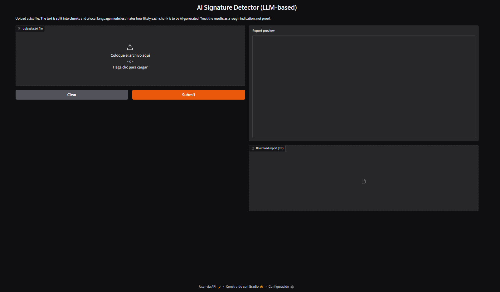
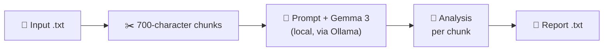

# 🕵️ AI Signature Detector (Gemma 3 + Ollama)

### Spot AI-written passages with a local LLM — private, no cloud, nothing leaves your machine


-4285F4?style=flat-square)


| 🔒 Private | 🧠 LLM-based | 🌐 Two interfaces | 🐳 Portable |
|---|---|---|---|
| Runs on your machine through Ollama | A local Gemma 3 model reviews every paragraph-sized chunk | Web app and terminal scripts | Docker Compose with app + Ollama |




## 💡 Overview

A side project built in my spare time to answer my **personal user need**: checking academic drafts for AI-generated text *without* uploading confidential, unpublished work to an online detector.

Instead of a trained classifier, this tool asks a **local language model** (Gemma 3, 4B parameters, served by Ollama) to review the text paragraph by paragraph. For each chunk it returns a perplexity estimate (Low / Medium / High), a predictability score (1–10), examples of sentences that look machine-generated, and a short explanation. Everything runs locally; the only network access is the one-time download of the model.

> [!NOTE]
> The "perplexity" and "predictability" values are **the model's own estimates from a prompt**, not measured token-level statistics. Treat the results as a rough indication, not proof. See [Model and Limitations](#-model-and-limitations).

## ✨ Features

- 🔒 **Local inference:** text is analysed by a model running on your own machine through Ollama.
- 📐 **Paragraph-sized chunks:** 700-character slices (roughly 100–120 words) that imitate an average academic paragraph.
- 🧾 **Rich per-chunk report:** perplexity estimate, predictability score, examples of suspicious sentences and a brief reasoning.
- 🌐 **Web app (Gradio):** upload, progress bar, report preview and one-click download.
- ⌨️ **Command-line scripts:** one for `gemma3:4b` and one for the quantization-aware-trained variant.
- 📥 **Automatic model download:** the web app pulls the model the first time it is needed.
- 🚦 **One analysis at a time:** requests are queued so the local model is never overloaded.
- 🛡️ **Clear errors:** friendly messages for missing or empty files and for an unreachable Ollama server.
- 🐳 **Docker Compose:** the app and Ollama start together, with a health check and a persistent model volume.

## 🛠️ Technical Highlights

| | Area | What this project shows |
|:---|---|---|
| 🧠 | **LLM engineering** | Structured prompt design, low temperature (0.1) for consistent output and a capped response length per chunk |
| 🔬 | **Iterative model selection** | Gemma 2 was not good enough at recognising AI-generated text, so the project moved to Gemma 3 (4B) and its quantization-aware-trained build |
| 🔒 | **Privacy by design** | Fully local inference; no document is sent to a third-party API |
| 🧩 | **Architecture** | Gradio app talking to Ollama over HTTP, configurable through environment variables (`OLLAMA_HOST`, `MODEL_NAME`) |
| 📦 | **Packaging** | Compose stack with a health check and `depends_on` ordering, a named volume for model weights and a non-root app container |
| ⚖️ | **Compliance** | Review of model terms (Gemma Terms of Use) and third-party licenses |

**Stack:** Python · Ollama · Gemma 3 · Gradio · Docker Compose

## 📋 Requirements

| Element | Version | Description |
|---|---|---|
| 🐍 **Python** | 3.10+ | Runtime (required by current Gradio) |
| 🦙 **Ollama** | Latest | Local LLM runtime; must be running (default address `localhost`, port `11434`) |
| 🧠 **Model** | `gemma3:4b-it-qat` (default) or `gemma3:4b` | Downloaded automatically on the first analysis, or in advance with `ollama pull` |
| 🔌 **ollama** (Python) | ≥ 0.4.0 | Client library for the Ollama API |
| 🎛️ **gradio** | ≥ 5.0 | Web interface |
| 🧮 **RAM** | 8 GB recommended | Running the 4B model |
| 💾 **Disk space** | 6 GB free | Ollama and model weights |
| 🌐 **Network** | First run only | One-time model download |
| 🐳 **Docker + Compose** | Compose v2 *(optional)* | Only for the container option |

Python packages are listed in `requirements.txt`.

## 🚀 Get Started

### 💻 Run locally

1. **Install Ollama** from [ollama.com](https://ollama.com) and make sure it is running.
2. *(Optional)* Download the model in advance: `ollama pull gemma3:4b-it-qat`. If you skip this, the web app downloads it on the first analysis.

```bash
# 3. Clone the repository
git clone https://github.com/polendol/AIDetectorGemma.git
cd AIDetectorGemma

# 4. Create and activate a virtual environment
python -m venv .venv
source .venv/bin/activate          # Windows: .venv\Scripts\activate

# 5. Install the dependencies
pip install -r requirements.txt

# 6. Start the web app
python app.py
```

The app runs on `localhost`, port `7860` by default, and is only reachable from your own computer. If that port is busy, Gradio picks the next free one and prints it in the terminal. Prefer the terminal? See [Command line](#%EF%B8%8F-command-line).

> [!TIP]
> The first analysis can take several minutes if the model has to be downloaded first. Later runs reuse it. If the app cannot reach Ollama, it shows an error with the address it tried.

### 🐳 Run with Docker

```bash
git clone https://github.com/polendol/AIDetectorGemma.git
cd AIDetectorGemma

docker compose up --build
```

Compose starts Ollama first, waits until it is healthy and then starts the web app. When the logs show that Gradio is running, the app is available on `localhost`, port `7860`.

- The first analysis downloads the model (a few GB) into a named volume (`ollama_data`). It is reused on every later run.
- The provided Compose file runs Ollama on **CPU**, so analysis is slower than with a GPU.
- Stop with `Ctrl+C` and `docker compose down`. Add `-v` to also delete the downloaded model.

> [!WARNING]
> With the provided `docker-compose.yml`, port `7860` is published on all network interfaces of the host, so other devices on the same network can also reach the app, and it has no authentication. Use it on trusted networks only. To restrict it to your own computer, change the port mapping to `127.0.0.1:7860:7860`. The Ollama service itself is **not** published to the host.

## 🎮 Usage

### 🌐 Web interface

1. Upload a `.txt` file.
2. Follow the progress bar while the chunks are analysed.
3. Read the preview and download the report. It is named after your file (`my_essay.txt` → `my_essay_report.txt`).

### ⌨️ Command line

```bash
python AI_detector_Gemma3.py          # gemma3:4b
python AI_detector_Gemma3qat.py       # quantization-aware-trained variant
```

The script asks for the name of the input `.txt` file and the name of the report to generate. The report is saved as a `.txt` file in the project.

### ⚙️ Configuration (web app)

| Variable | Default | Description |
|---|---|---|
| `OLLAMA_HOST` | `http://localhost:11434` | Address of the Ollama server (Docker Compose sets `http://ollama:11434`) |
| `MODEL_NAME` | `gemma3:4b-it-qat` | Model used for the analysis, for example `gemma3:4b` |

```bash
MODEL_NAME=gemma3:4b python app.py        # Linux / macOS
set MODEL_NAME=gemma3:4b && python app.py # Windows (cmd)
```

> [!CAUTION]
> If you point `OLLAMA_HOST` at another machine, your text is sent to that machine. Keep the default for fully local processing.

## 📄 Example Output

```text
AI DETECTION REPORT
Model used: gemma3:4b-it-qat
Total Chunks: 2

--- CHUNK 1 ---
TEXT: <first 100 characters of the chunk>...
ANALYSIS:
1. PERPLEXITY ESTIMATE: Low
2. PREDICTABILITY SCORE: 8
3. EXAMPLES: <sentences the model considers typical of AI-generated text>
4. ANALYSIS: <brief reasoning>

**************************************************
--- CHUNK 2 ---
...
```

*Illustrative. The model answers in free text, so wording and layout can vary between chunks and runs.*

| Field | Meaning |
|---|---|
| 📉 **PERPLEXITY ESTIMATE** | `Low`, `Medium` or `High`, estimated by the model; low suggests highly predictable text |
| 🤖 **PREDICTABILITY SCORE** | From `1` to `10`, where `10` means highly robotic |
| 🔎 **EXAMPLES** | Sentences or structures the model considers most likely to be AI-generated |
| 💬 **ANALYSIS** | Brief reasoning behind the assessment |

## ⚙️ How It Works



The text is split into consecutive chunks of 700 characters. Each chunk is sent to the model with the prompt below; the model runs with a low temperature (0.1) for objectivity, and its answer is limited to about 1,000 tokens. The answers are collected into one report.

<details>
<summary>Show the prompt</summary>

```text
INSTRUCTION: Analyze this text for AI signatures. Provide the following in your report:
1. PERPLEXITY ESTIMATE: (Low/Medium/High)
2. PREDICTABILITY SCORE: (1-10, where 10 is highly robotic)
3. EXAMPLES: specific examples of all sentences or structures in the text most probably generated by AI.
4. ANALYSIS: Brief reasoning.

TEXT:
<chunk>

REPORT:
```

</details>

## 🧠 Model and Limitations

**Model:** [Gemma 3](https://ai.google.dev/gemma) (4B parameters), run locally through [Ollama](https://ollama.com). The default is `gemma3:4b-it-qat`, a quantization-aware-trained build with a smaller memory footprint; `gemma3:4b` is the alternative. **No model weights are stored in this repository or in the Docker images.**

| | Design notes |
|:---|---|
| 🧪 | **Method:** prompt-based "LLM as a judge". There is no fine-tuning, no training data and no labelled benchmark |
| 📏 | **Chunk size:** 700 characters, chosen to resemble the length of a typical academic paragraph |
| 🎯 | **Why Gemma:** it comes from the same research lineage as Gemini, so it was chosen to try to recognise Gemini-style structures. This has not been validated |

> [!WARNING]
> **This is a heuristic, not a measurement.** A language model cannot compute its own perplexity from a prompt; the numbers are subjective estimates and can change between runs. Formal, formulaic academic prose can look "predictable" to any detector, so **false positives are possible**, and AI text can also go unnoticed.

Other known limits:

- 🧠 **Small model:** a 4B model has limited reasoning and can be inconsistent.
- 📝 **Free-text output:** reports are not machine-parseable and there is no document-level score.
- ✂️ **Fixed-size chunks:** cuts without overlap can split words or sentences, and chunks do not follow the real paragraphs of your document.
- 🚧 **Failed chunks:** if the model call fails, the error message is written into the report instead of stopping the run.
- 🚦 **Sequential processing:** one analysis at a time, and long documents can take a while on CPU.

## 🔒 Privacy

- 🏠 Text is analysed by a local model through Ollama; documents are never sent to a third-party service.
- 📡 The only outbound connection is the model download the first time it is needed. Afterwards the tool can work offline.
- 📊 Gradio sends anonymous usage analytics by default; disable them with `GRADIO_ANALYTICS_ENABLED=False`.
- 🗑️ **Temporary files:** the web app leaves temporary copies of uploads and reports, which are not deleted automatically. With Docker they stay inside the container and disappear with `docker compose down`.
- 📝 **Reports are as sensitive as the source:** each one contains a 100-character preview of every chunk and may quote the passages the model flags.
- 💾 **Command-line reports** are saved in the project folder. Keep documents and reports in a folder that is never committed to version control.
- 🌐 **Network exposure:** run locally (`python app.py`), the web app listens on `localhost` only. With Docker, the provided `docker-compose.yml` publishes port `7860` on all host network interfaces, so other devices on your network can reach it. The app has no authentication, so use Docker on trusted networks or publish the port as `127.0.0.1:7860:7860` to keep it private. The Ollama API is not published.
- 🔌 **Remote Ollama:** if you set `OLLAMA_HOST` to another machine, your text travels to that machine.

## 🗂️ Project Structure

```text
.
├── app.py                      # Gradio web app
├── AI_detector_Gemma3.py       # Command-line version (gemma3:4b)
├── AI_detector_Gemma3qat.py    # Command-line version (QAT variant)
├── requirements.txt            # Python dependencies
├── AI.txt                      # Short sample AI-generated text for quick testing
├── Dockerfile                  # python:3.12-slim, non-root user (web app)
├── docker-compose.yml          # Web app + Ollama, health check, model volume
├── LICENSE                     # MIT License
└── README.md                   # This file
```

## 🗺️ Roadmap

- [ ] 📊 Benchmark on labelled human vs. AI academic text (precision, recall, F1)
- [ ] 📉 Compute real token-level perplexity from model log-probabilities instead of asking the LLM to estimate it
- [ ] 🧾 Structured (JSON) output and a document-level summary score
- [ ] ✂️ Paragraph- or sentence-aware chunking with overlap
- [ ] 🔀 Choose the model from the web interface
- [ ] 🧱 Shared core module for the web app and the command-line scripts
- [ ] 🧹 Automatic cleanup of temporary files
- [ ] 📑 `.docx` and `.pdf` input
- [ ] ⚡ Optional GPU support in Docker Compose
- [ ] 📌 Pinned dependency versions for reproducible builds
- [ ] ✅ Automated tests and CI

## ⚠️ Responsible Use

> [!CAUTION]
> AI-text detection is probabilistic and **error-prone, including false positives against human writers**. Do not use this tool's output as the sole basis for academic-integrity, hiring or disciplinary decisions. Treat it as one weak signal and always allow for human review.

## ⚖️ License

Released under the **[MIT License](LICENSE)**. Copyright (c) 2026 polendol

The MIT License covers **only this project's own code and documentation**. Third-party models and libraries are not redistributed here and keep their own terms.

> This software is provided "as is", without warranty of any kind. This is an independent project, not affiliated with or endorsed by Google, Ollama, Gradio or Docker. Gemma and Gemini are trademarks of Google. All product names and trademarks belong to their respective owners.

### 📜 Third-Party Licenses

| Component | Role | License | Notes |
|---|---|---|---|
| [Gemma 3](https://ai.google.dev/gemma) (`gemma3:4b-it-qat`, `gemma3:4b`) | Language model | ⚠️ **[Gemma Terms of Use](https://ai.google.dev/gemma/terms)** and **[Prohibited Use Policy](https://ai.google.dev/gemma/prohibited_use_policy)**, a custom license and not an open-source one (terms last modified 1 Apr 2026, checked 13 Oct 2026) | Not included in this repository or in any image. Each user downloads the model through Ollama and is bound by these terms. |
| [Ollama](https://github.com/ollama/ollama) | Local LLM runtime | MIT | Also distributed as the `ollama/ollama` Docker image |
| [ollama-python](https://github.com/ollama/ollama-python) | Python client | MIT | |
| [Gradio](https://github.com/gradio-app/gradio) | Web interface | Apache 2.0 | |

> [!NOTE]
> The Gemma terms apply to anyone who uses the model, including people who use it through a service you host, and other Gemma generations may be under different terms. Read them before hosting this app for others or switching models.

The Docker setup is built locally from the official `python:3.12-slim` image (Python Software Foundation License, plus Debian packages under their own licenses) and the official `ollama/ollama` image; no image is distributed with this repository.

## 🙏 Acknowledgments

Thanks to the **Google DeepMind** team for Gemma, to the **Ollama** maintainers for making local models easy to run, and to the **Gradio** community.

## 📚 Citation

If you build on the underlying model, please cite:

- Gemma Team, Google DeepMind. *Gemma 3 Technical Report.* [arXiv:2503.19786](https://arxiv.org/abs/2503.19786)

## 👤 Author

**`Paulina Olender`** — NLP / Machine Learning

Feedback, issues and suggestions are welcome. If this tool is useful to you, a ⭐ is appreciated.

